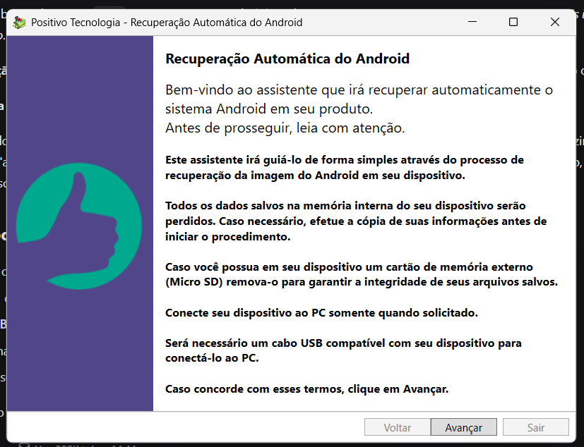
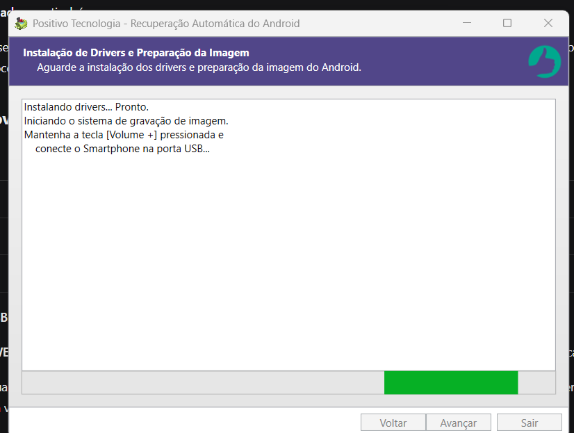

# Reflash: gravando a ROM oficial

O coracao do processo. Aqui a ROM de fabrica e gravada por cima de tudo,
apagando dados, senha e configuracoes.

Tempo: 10 a 12 minutos, mais a extracao.

---

## Telas do processo

Assistente da Positivo na abertura. E a casca que vai falhar mais adiante:



Estado de espera do gravador, com a instrucao da tecla. O tablet deve estar
desligado e a tela dele deve ficar preta:



---

## 1. De onde vem o arquivo

### Caminho oficial, por numero de serie

Pagina da Positivo:

```
https://www.meupositivo.com.br/para-voce/suporte-tecnico/recuperacao-android
```

Digite o numero de serie do aparelho e baixe o pacote. O proprio site avisa que
o procedimento apaga todos os dados.

### Caminho alternativo, pelo manual do CIEQ

O Centro de Informacoes Educacionais da Secretaria da Educacao de Sao Paulo
publica um manual com links diretos por modelo:

```
https://drive.google.com/file/d/1vnIjEM87SUkgpjeM6r7VkTdgCBqRESTd/view
```

O manual lista:

| Modelo | Arquivo |
|---|---|
| T2040B | `PositivoRescuerInstaller_T2040B_11178165.exe` |
| T2040C | `PositivoRescuerInstaller_T2040C_11178161.exe` |

E informa a tecla correta de cada um: Volume **menos** no T2040, Volume
**mais** no T2040B.

### Link direto do arquivo

O manual aponta para um endereco do servidor da Positivo, hospedado na
Embratel:

```
https://object.spo1.edge.embratel.cloud/v1/KEY_6f4e00d2e02848e7aabd101575f6a5fc/Recovery2022/android/tabletsDC/T2040B/PositivoRescuerInstaller_T2040B_11178165.exe
```

Atencao: esse endereco contem um token (`KEY_...`). Ele funciona por tempo
limitado. Se der erro 403, use a pagina oficial com o numero de serie.

Nunca baixe de site de terceiro. Os pacotes que circulam como "Q10 T2040" e
"Pro X T2040" sao de outro aparelho.

---

## 2. Verificar o arquivo

Tamanho e hash do arquivo oficial do T2040B:

| Item | Valor |
|---|---|
| Nome | `PositivoRescuerInstaller_T2040B_11178165.exe` |
| Bytes | 1.557.124.300 |
| Tamanho aproximado | 1,49 GB |
| SHA-256 | `3F6C0A8ABA8CBBF5DB1DCFD1D998FA07EECCA58B01A153CEF93FF41CA105B3A1` |
| Assinatura | nao assinado (normal nessa ferramenta) |
| Metadados | `PositivoAndroidRescuer`, Positivo Informatica |

Conferir no PowerShell:

```powershell
Get-FileHash .\PositivoRescuerInstaller_T2040B_11178165.exe -Algorithm SHA256
```

O script `01-baixar-instalador.ps1` faz isso automaticamente.

---

## 3. O que tem dentro

O arquivo e um envelope 7-Zip com 380 entradas. O que interessa:

```
AndroidRescuer/
├── ROM_Android/11178165/Positivo_T2040B_V001_03312022.pac   3.254,7 MB
├── Gravador_Imagens/Tools/UPGRADEDOWNLOAD_R20.0.0001_+/
│   ├── CmdDloader.exe                     gravador por linha de comando
│   ├── UpgradeDownload.exe                gravador com interface
│   ├── CmdDloader.ini
│   └── UpgradeDownload.ini
├── Drivers/Drivers_S545/                  driver de comunicacao
├── Config/
│   ├── ModelsConfig.xml                   mapa de modelos e teclas
│   ├── ImagesConfig.xml                   qual ROM para qual modelo
│   └── FlashToolsConfig.xml               qual ferramenta para qual familia
└── PositivoAndroidRescuer.exe             o assistente grafico
```

Dois arquivos de configuracao confirmam o que fazer:

`ModelsConfig.xml`, linha do T2040B:

```xml
<Model Name="T2040B" MarketingName="Positivo T2040B"
       Preloader_VID="1782" Preloader_PID="4D00" PreloaderTimeoutSecs="600">
  <DriverInstall>Drivers_S545</DriverInstall>
  <PreLoaderActivation>Sempre mantenha pressionada a tecla [Volume +] antes de conectar o cabo USB.</PreLoaderActivation>
</Model>
```

`ImagesConfig.xml`:

```xml
<Image Code="11178165" FlashTool="UPGRADEDOWNLOAD_R20.0.0001_+" />
```

Ou seja: o proprio fabricante diz que o T2040B usa Unisoc, VID 1782, PID 4D00,
tecla Volume +, e a ferramenta UpgradeDownload.

### Por que nao usar o assistente grafico

O `PositivoAndroidRescuer.exe` e uma casca que dispara ferramentas de varios
fabricantes. O codigo dele mostra:

```powershell
$currentComPorts = [System.IO.Ports.SerialPort]::GetPortNames()
do {
    $port = [System.IO.Ports.SerialPort]::GetPortNames() |
            ? { $currentComPorts -notcontains $_ } | ...
    Start-Sleep -Seconds 1 ; $i++
} While(-not $port -and $i -lt 60)
if ($i -ge 60) { ExitToHost "E_MTK_DETECT_DEVICE_TIMEOUT" }
```

Ele espera 60 segundos por uma porta serial **nova**. Sem o driver carregado,
essa porta nunca aparece, e o erro que voce ve na tela e o timeout. Alem disso,
o codigo de erro tem prefixo `MTK`, de MediaTek, o que confunde o diagnostico.

Chamar o `CmdDloader` direto elimina a casca, o cronometro e a confusao.

---

## 4. Extrair

```powershell
& "C:\Program Files\7-Zip\7z.exe" x -y "-o$PWD\ferramentas\rescuer" `
  ".\ferramentas\PositivoRescuerInstaller_T2040B_11178165.exe"
```

Saida esperada:

```
Folders: 62
Files: 318
Size: 3559896100
Compressed: 1557124300
```

Confira os dois arquivos principais:

```powershell
Test-Path ".\ferramentas\rescuer\AndroidRescuer\ROM_Android\11178165\Positivo_T2040B_V001_03312022.pac"
Test-Path ".\ferramentas\rescuer\AndroidRescuer\Gravador_Imagens\Tools\UPGRADEDOWNLOAD_R20.0.0001_+\CmdDloader.exe"
```

---

## 5. Dois ajustes nos arquivos .ini

Ambos ficam na pasta do gravador. Os arquivos estao em codificacao antiga
(chinesa), entao edite com cuidado, ou use o script.

### `CmdDloader.ini`

```ini
[Setting]
FlashApp=UpgradeDownload.exe
PipeName = UpgradeDownload
ShowProcess = 1
EZMode = 0
;WaitDUTTimeout unit is milliscond
WaitDUTTimeout = 900000
```

**Original:** `WaitDUTTimeout = 0`. O zero faz o gravador desistir na hora se o
tablet nao estiver pronto no instante em que ele termina de descompactar a ROM.
Com `900000` (15 minutos), ele espera voce conectar.

### `UpgradeDownload.ini`

```ini
[Serial port]
Port=0
Baud rate=460800

[Options]
Repartition=1
Reset=1
EraseAll=0

[PortSetting]
FilterPort=1,2
EnableFilter = 0
```

**Original:** `EnableFilter = 1`. Isso restringe o gravador as portas COM1 e
COM2. O tablet aparece na COM4, entao o filtro precisa sair.

**Tambem:** `[Report] enable=` de `0` para `1`, para o gravador gravar o arquivo
`download_result.txt` com o resultado final.

Nao mexa em `Repartition`, `Reset` nem `EraseAll`. Os valores de fabrica
(`1`, `1`, `0`) estao corretos para gravar a ROM inteira sem reparticionar.

---

## 6. Preparar o terreno

Antes de disparar:

1. Feche o assistente da Positivo, se estiver aberto.
2. Encerre processos antigos:

```powershell
Get-Process | Where-Object { $_.ProcessName -match 'CmdDloader|UpgradeDownload' } | Stop-Process -Force
```

3. Apague restos de tentativas anteriores:

```powershell
Remove-Item ".\ferramentas\rescuer\AndroidRescuer\Gravador_Imagens\Tools\UPGRADEDOWNLOAD_R20.0.0001_+\download_result.txt" -ErrorAction SilentlyContinue
Remove-Item ".\ferramentas\rescuer\AndroidRescuer\Gravador_Imagens\Tools\UPGRADEDOWNLOAD_R20.0.0001_+\result.txt" -ErrorAction SilentlyContinue
```

4. Confirme que o tablet esta **desligado** e o cabo **desconectado**.

---

## 7. Disparar o gravador

```powershell
$tool = ".\ferramentas\rescuer\AndroidRescuer\Gravador_Imagens\Tools\UPGRADEDOWNLOAD_R20.0.0001_+"
$pac  = ".\ferramentas\rescuer\AndroidRescuer\ROM_Android\11178165\Positivo_T2040B_V001_03312022.pac"

Start-Process -FilePath (Join-Path $tool "CmdDloader.exe") `
  -ArgumentList @('-pac', "`"$pac`"", '-port', '4') `
  -WorkingDirectory $tool
```

O script `03-reflash.ps1` faz isso e ainda acompanha o progresso.

### Cronologia esperada

| Tempo | O que acontece |
|---|---|
| 0 a 40 s | descompacta o `.pac` para a pasta `ImageFiles` (chega a 3,2 GB) |
| 40 s em diante | fica esperando o dispositivo na COM4, por ate 15 minutos |
| apos conectar | le o IMEI, carrega o FDL, comeca a gravar |
| mais 8 a 10 min | gravacao real, cerca de 89 mil blocos |
| final | envia comando de reset, o tablet reinicia |

Durante a descompactacao, o conteudo de `ImageFiles` cresce em saltos. E normal
ver `285 MB`, depois `2.144 MB`, depois `3.254 MB`.

---

## 8. Colocar o tablet em modo download

Esta e a parte que exige mais atencao.

1. **Desligue o tablet de verdade.** Segure POWER por 15 segundos. Espere a tela
   apagar completamente. Se aparecer icone de bateria, ele NAO esta desligado.
2. Segure **VOLUME +** e mantenha.
3. Encaixe o cabo USB no tablet.
4. Continue segurando por 15 segundos.
5. Pode soltar.

**Criterio de sucesso: a tela fica preta, nada aparece.**

Se aparecer o logo da Positivo ou o desenho da bateria, o modo download nao
entrou. Desconecte, desligue de novo, repita.

### Por que a pressa importa

O Boot ROM desiste depois de cerca de 16 segundos sem conversa. Por isso o
gravador precisa ja estar esperando. Com `WaitDUTTimeout = 900000`, ele espera.
Por isso o ajuste da secao 5 e obrigatorio.

---

## 9. Como saber que deu certo

### Na tela do script

```
[COMD] IMEI:<IMEI>    PASS
```

### Nos arquivos do gravador

`download_result.txt`:

```
2026-11-20 17:17:07[COM4]	IMEI:<IMEI>     	PASS
```

`result.txt`:

```
success
```

### No log detalhado

Arquivo `Log/BootModeOpr_COM_4_AAAA-MM-DD.log`, ultimas linhas:

```
End Data: Success.
[INFO] FileID=_RESET_, operations for file type Reset
Reset: Success.
Disconnect Channel +++
Finish Successful.
```

Depois disso o tablet some do USB e reinicia sozinho.

---

## 10. Se falhar

| Erro | Causa | Solucao |
|---|---|---|
| `E_MTK_DETECT_DEVICE_TIMEOUT` no assistente | driver nao carregou | ver [03-driver-windows.md](03-driver-windows.md) |
| `Check Baudrate: Fail [142: Wait input time out]` | tablet nao estava em modo download quando o gravador falou | repetir com o tablet desligado de verdade |
| `Download (0x...): Fail [257: Uart send error]` | link caiu no meio, cabo removido ou BROM reiniciou | repetir, nao mexer no cabo |
| `Finish Failed` com `User cancel` | o gravador cancelou apos falha de comunicacao | repetir |
| `ImageFiles` nunca cresce | antivirus bloqueando ou pouco espaco | liberar e conferir espaco |

Planilha completa em [09-troubleshooting.md](09-troubleshooting.md).

---

## 11. Alternativa: UpgradeDownload com interface

Se preferir a interface grafica, rode:

```powershell
Start-Process ".\ferramentas\rescuer\AndroidRescuer\Gravador_Imagens\Tools\UPGRADEDOWNLOAD_R20.0.0001_+\UpgradeDownload.exe" -WorkingDirectory ".\ferramentas\rescuer\AndroidRescuer\Gravador_Imagens\Tools\UPGRADEDOWNLOAD_R20.0.0001_+"
```

Na janela:

1. Clique no icone de pasta ou engrenagem e carregue o `.pac`.
2. Clique no botao de iniciar (seta para baixo ou play).
3. Segure VOLUME + e conecte o tablet.
4. Aguarde a barra de progresso ate o fim.

A ferramenta e em ingles ou chines, dependendo da versao, e nao tem botao de
cancelar claro. O `CmdDloader` costuma ser mais previsivel.
