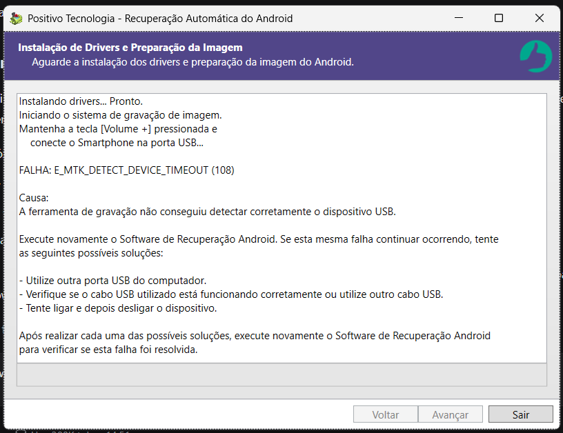

# Solucao de problemas

Todos os erros que apareceram no caso real, com a causa e a solucao exata.
Procure pela mensagem que voce viu na tela.

---

## Durante o download

### `[e500-2_0] Nao foi possivel obter os arquivos de recuperacao Android`

**Onde:** pagina de Recuperacao Eletronica da Positivo, apos digitar o numero de
serie.

**Causa:** falha interna do servidor da Positivo, nao significa serial invalido.

**Solucao:**

1. Tente novamente mais tarde.
2. Use o link direto do manual do CIEQ (documento 04).
3. Se o link direto der 403, o token expirou. Nesse caso so resta a pagina
   oficial ou pedir o arquivo ao suporte com o numero de serie.

### `The SSL connection could not be established`

**Causa:** proxy, antivirus ou inspecao TLS no Windows.

**Solucao:** baixe pelo navegador em vez de PowerShell, ou desative
temporariamente a inspecao HTTPS do antivirus.

### Hash diferente do esperado

**Causa:** download incompleto ou arquivo adulterado.

**Solucao:** apague e baixe de novo. O hash correto esta em `dados/dispositivo.md`.

---

## Durante a extracao

### `7z.exe nao encontrado`

**Solucao:**

```powershell
winget install 7zip.7zip
```

Ou baixe em `https://www.7-zip.org/`.

### `Cannot open file ... access denied`

**Causa:** antivirus lendo o arquivo durante a extracao.

**Solucao:** aguarde e tente de novo, ou adicione a pasta de exclusao.

### Extracao para no meio, com pouco espaco

**Causa:** sao 3,6 GB de saida. Verifique o espaco livre.

```powershell
Get-PSDrive C | Select-Object Free
```

---

## Durante a gravacao

### `E_MTK_DETECT_DEVICE_TIMEOUT (108)`

**Onde:** assistente grafico da Positivo.



**Causa:** o script espera 60 segundos por uma porta serial que nunca aparece,
porque o driver nao carregou.

**Solucao:** ver [03-driver-windows.md](03-driver-windows.md). Resumo:

1. Reinicie o Windows com a imposicao de assinatura de driver desativada
   (Configuracoes, Recuperacao, Inicializacao avancada, opcao 7).
2. Confirme que `GetPortNames()` retorna `COM4`.
3. Use `CmdDloader` direto em vez do assistente.

### `Check Baudrate: Fail. [142: Wait input time out]`

**Onde:** log `BootModeOpr_COM_4_*.log`.

**Causa:** o gravador abriu a porta e escreveu, mas o tablet nao respondeu.
Geralmente significa que o tablet **nao estava mais** em modo download naquele
instante, ou que a porta era um registro fantasma.

**Solucao:**

1. Certifique-se de que o tablet esta **desligado de verdade**.
2. Confirme que `WaitDUTTimeout` esta em `900000`.
3. Ligue o tablet so depois que o gravador estiver esperando.

### `Download (0x0144C000): Fail. [257: Uart send error]`

**Causa:** o link USB caiu no meio da gravacao. Cabo removido, mau contato,
hub USB, ou o Boot ROM reiniciou.

**Solucao:** repita a gravacao. Use porta USB direto no PC, sem hub, e nao
encoste no cabo.

### `Finish Failed` com `User cancel`

**Causa:** consequencia de uma falha de comunicacao anterior.

**Solucao:** repetir. Nao e falha do arquivo.

### A tela do tablet mostra logo da Positivo e depois bateria

**Causa:** o modo download nao entrou. O aparelho ligou normalmente.

**Solucao:**

1. Desconecte.
2. Segure POWER por 15 segundos ate a tela apagar completamente.
3. Espere 5 segundos.
4. Segure **VOLUME +** e conecte o cabo, mantendo.
5. Criterio de sucesso: tela **preta**, sem logo.

### O dispositivo aparece e some a cada 16 segundos

**Causa:** comportamento normal do Boot ROM. Ele espera cerca de 16 segundos por
conversa e reinicia se ninguem falar.

**Solucao:** garanta que o gravador ja esta esperando antes de conectar.

### `ImageFiles` nao cresce

**Causa:** antivirus bloqueando a descompactacao, ou espaco insuficiente.

**Solucao:** libere espaco e adicione a pasta do gravador nas exclusoes.

---

## Durante o fastboot

### `FAILED (remote: 'Flashing Lock Flag is locked. Please unlock it first!')`

**Causa:** bootloader travado. Esperado neste modelo.

**Solucao:** nao ha. Use o modo download e o reflash.

### `FAILED (remote: 'unknown cmd.')` em qualquer `fastboot oem`

**Causa:** o fastboot deste modelo e um stub.

**Solucao:** nao ha. Use o modo download.

### `fastboot -w` responde `Finished` mas nao apaga nada

**Causa:** o comando engole o erro real. E uma pegadinha.

**Solucao:** nunca confie nele. Use `fastboot erase userdata` para ver a
mensagem verdadeira.

---

## Durante o ADB

### `adb: no devices/emulators found`

**Causas possiveis:**

| Causa | Verificacao | Solucao |
|---|---|---|
| cabo de carga | o tablet carrega mas nao aparece | trocar cabo |
| depuracao USB desligada | opcoes do desenvolvedor | ligar |
| modo MTP apenas | `pnputil` mostra `PID_4001` | ligar depuracao USB |
| driver ausente | Gerenciador de Dispositivos com alerta | instalar driver |

### `device unauthorized`

**Causa:** o aviso de autorizacao nao foi aceito.

**Solucao:** desbloqueie o tablet e aceite o aviso. Se o aviso **nao aparecer**
com a tela bloqueada, nao ha como autorizar sem desbloquear. Nesse caso o
caminho e o reflash.

### `adb server version doesn't match`

**Solucao:**

```powershell
adb kill-server
adb start-server
```

---

## Depois do reflash

### `Este dispositivo pertence a sua organizacao`

**Causa:** provisionamento Android Enterprise.

**Solucao:** [05-setup-offline.md](05-setup-offline.md). Resumo: configurar sem
internet, depois desativar `com.android.managedprovisioning` e
`com.google.android.partnersetup`, e remover
`android.autoinstalls.config.positivo.T2040B`.

### O tablet ficou preso na tela de inscricao institucional

**Causa:** a inscricao chegou antes do bloqueio.

**Solucao:** reflashar de novo e seguir o documento 05 na ordem, sem conectar
rede antes do bloqueio.

### O tablet nao passa da logo da Positivo

**Causa:** gravacao incompleta ou interrompida.

**Solucao:** reflashar. O modo download continua acessivel mesmo que o Android
nao suba, porque o Boot ROM e anterior ao sistema.

### Alguns aplicativos nao aparecem na Play Store

**Causa:** o aparelho e 32 bits. Aplicativos que so existem em 64 bits nao sao
oferecidos.

**Solucao:** nao ha. Procure alternativa compativel.

---

## Problemas de ambiente

### `A execucao de scripts foi desabilitada neste sistema`

**Causa:** politica de execucao do PowerShell.

**Solucao:** os atalhos `.bat` ja chamam o PowerShell com
`-ExecutionPolicy Bypass`. Se estiver rodando manualmente:

```powershell
powershell -ExecutionPolicy Bypass -File .\scripts\05-remover-apps.ps1
```

### `Acesso negado` ao rodar script de driver

**Causa:** sem privilegios de administrador.

**Solucao:** abra o PowerShell com botao direito, Executar como administrador.

---

## Quando desistir e pedir ajuda

Se depois de reflashar duas vezes o aparelho nao ligar, e o modo download
continuar funcionando, o problema provavelmente e hardware ou ROM corrompida.
Vale procurar o suporte da Positivo com o numero de serie, ou o canal de
atendimento educacional se o aparelho veio de escola.
